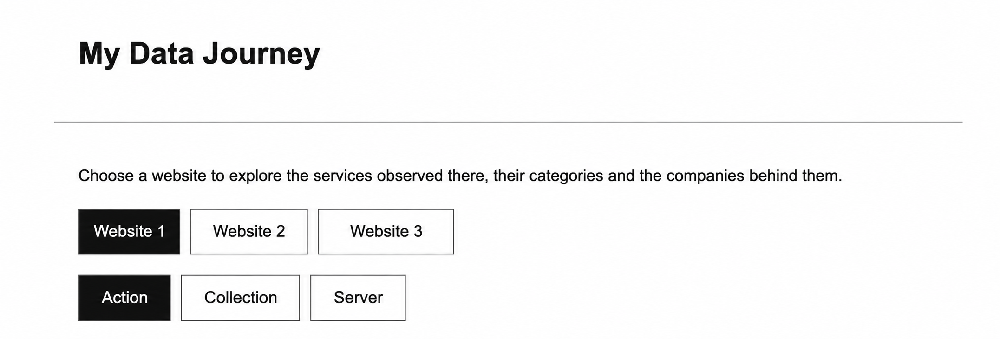

# My Data Journey



This is an example of a webpage layout and interaction you might use as a reference. You will explore three websites for Journey Map. For each stage of your journey, try to add **at least one visual element** that helps explain your evidence.

Link to the example online: https://git.arts.ac.uk/pages/d-ding/2026-2027-DingD//Term-1/Critical-Coding-Practices/week-7/Prototype/web/index.html
## HTML

- `<header>` and `<h1>` for the page title.
- `<main>` and `<section>` for the main page content.
- `<p>` for the introduction and the explanation of each stage.
- `<div>` and `<button>` for the two rows of buttons.
- `<h2>`, `<p>` and `<div>` for the shared display panel.
- `<template>` for the visual evidence for each website and stage.
- `<link>` and `<script>` to connect the CSS and JavaScript files.

The example shows one website button, one stage button and one template. Complete each button row with three buttons, try to use the values `0`, `1` and `2` in each row. Add a matching template for each website and stage combination. For example, `site-1-step-2` holds the visual evidence for the second website’s Server stage.

```html
<!doctype html>
<html lang="en">
<head>
  <meta charset="utf-8">
  <meta name="viewport" content="width=device-width, initial-scale=1">
  <title></title>
  <link rel="stylesheet" href="style.css">
  <script src="script.js" defer></script>
</head>
<body>
  <header>
    <h1></h1>
  </header>
  <main>
    <section id="journey">
      <p></p>

      <div class="controls" id="site-buttons" role="group" aria-label="Website">
        <button type="button" data-site="0"></button>
      </div>

      <div class="controls" id="step-buttons" role="group" aria-label="Journey stage">
        <button type="button" data-step="0"></button>
      </div>

      <div class="panel">
        <h2 id="step-title"></h2>
        <p id="step-text"></p>
        <div id="step-chart"></div>
      </div>
    </section>
  </main>

  <template id="site-0-step-0">
    <!-- Add visual evidence here. -->
  </template>
</body>
</html>
```

## CSS

Try with the suggested properties to choose your own spacing, colours and background or add more decoration. * The `aria-pressed` and `aria-current` selectors target the selected button in each row.

```css
body {
  margin: 0;
  /* font-family: ; */
  /* background: ; */
  /* color: ; */
}

.controls {
  display: flex;
  flex-wrap: wrap;
  /* gap: ; */
}

button {
  font:  inherit;
  cursor:  pointer;
  /* padding: ; */
}

.controls button[aria-pressed="true"],
.controls button[aria-current="step"] {
  /* background: ; */
  /* color: ; */
}

.panel {
  /* padding-block: ; */
}

img, video { max-width: 100%; height: auto; }
.table-scroll { overflow-x: auto; }
[hidden] { display: none; }
```

## JavaScript

**1. Set up the data and the starting selection**

The `reports` array starts empty. It holds the website reports after JavaScript reads the JSON file saved by Python.

```javascript
let reports = [];

// Start by defining two variables to track the selection.
// siteIndex tracks which website is selected.
// 0 means Website 1, 1 means Website 2, and 2 means Website 3.
let siteIndex = 0;

// stepIndex tracks which stage is selected.
// 0 means Action, 1 means Collection, and 2 means Server.
let stepIndex = 0;

// Both variables start at 0, so the page initially shows
// the Action stage for Website 1.

const siteButtons = document.querySelectorAll("#site-buttons [data-site]");
const stepButtons = document.querySelectorAll("#step-buttons [data-step]");
const title = document.getElementById("step-title");
const text = document.getElementById("step-text");
const chart = document.getElementById("step-chart");

const stepNames = ["Action", "Collection", "Server"];
```

**2. Read the saved reports**

Python prepares the reports and saves them to `result/journey.json`. JavaScript loads that saved file when the page opens. `response.json()` turns the response into JavaScript data. Save that data in `reports` before calling `showStep()`, so the first view has a website report to display.

```javascript
// Read the saved Python results
async function loadResults() {
  try {
    const response = await fetch("result/journey.json");
    if (!response.ok) {
      throw new Error("Could not open result/journey.json.");
    }

    reports = await response.json();
    showStep();
  } catch (error) {
    text.textContent = "Could not load the website reports. Check the file path and local server.";
    console.error(error);
  }
}
```

**3. Display the selected website and stage**

`reports[siteIndex]` picks one website report. `stepIndex` selects the Action, Collection or Server branch. The examples use fields from the reference JSON, including `domain`, `count` and `categories`. Use these lines as a starting point for explaining your own evidence.

`chart.replaceChildren()` clears the previous visual. Then `showStep()` copies any evidence you placed in the matching HTML template into the shared panel. If your HTML still has only the first example template, that view is the only one with a place to store a visual until you add the others.

```javascript
function showStep() {
  const report = reports[siteIndex];
  if (!report) return;

  title.textContent = report.domain + " — " + stepNames[stepIndex];
  chart.replaceChildren();

  if (stepIndex === 0) {
    text.textContent = "We observed " + report.count + " distinct services.";
    // Add evidence of the action you took.
  } else if (stepIndex === 1) {
    const categories = report.categories.map((category) => category.name);
    text.textContent = "Observed categories include " + categories.join(", ") + ".";
    // Add a bar graph or table to compare the categories.
  } else {
    text.textContent = "Explore the providers behind the observed services.";
    // Add evidence of service ownership or the routes you observed.
  }

  const templateId = "site-" + siteIndex + "-step-" + stepIndex;
  const template = document.getElementById(templateId);
  if (template) {
    chart.append(template.content.cloneNode(true));
  }

  for (const button of siteButtons) {
    button.setAttribute("aria-pressed", Number(button.dataset.site) === siteIndex);
  }

  for (const button of stepButtons) {
    if (Number(button.dataset.step) === stepIndex) {
      button.setAttribute("aria-current", "step");
    } else {
      button.removeAttribute("aria-current");
    }
  }
}
```

**4. Listen for button clicks**

JavaScript reads each button’s index through `dataset` and converts it from text to a number using `Number()`.

```javascript
// The data-site and data-step attributes on the HTML buttons
// provide the index values.
//
// Clicking the button with data-site="1" updates siteIndex to 1.
// If stepIndex is already 2, showStep() displays the Server stage
// for Website 2 using the HTML template site-1-step-2.
for (const button of siteButtons) {
  button.addEventListener("click", () => {
    siteIndex = Number(button.dataset.site);
    showStep();
  });
}

for (const button of stepButtons) {
  button.addEventListener("click", () => {
    stepIndex = Number(button.dataset.step);
    showStep();
  });
}

// Add any JavaScript for your visuals here.

loadResults();
```

## Four visual elements to try

Separate examples are available in the Week 7 folder under `visual_elements_examples`.

Paste the HTML for a visual **inside the template for the relevant website and stage**. Replace the example numbers, labels, captions and file paths with your own evidence.

### 1. Bar graph

Use a bar graph to compare quantities. Here both bars use the same scale. Replace the example counts and choose a common maximum that fits your data.

```html
<figure>
  <figcaption>Observed services by category</figcaption>
  <p>Analytics <meter min="0" max="10" value="8" aria-label="Analytics"></meter> 8</p>
  <p>Advertising <meter min="0" max="10" value="4" aria-label="Advertising"></meter> 4</p>
</figure>
```

For a version with axes, see the [W3Schools Chart.js bar graph example](https://www.w3schools.com/js/tryit.asp?filename=trychartjs_bars_colors_more).

### 2. Rows and columns table

Use a table when readers need exact values or need to compare individual records. Add one `<tr>` per record in the table body.

```html
<div class="table-scroll">
  <table>
    <caption>Services observed on this website</caption>
    <thead>
      <tr><th scope="col">Service</th><th scope="col">Category</th></tr>
    </thead>
    <tbody>
      <tr><td>Example service</td><td>Analytics</td></tr>
    </tbody>
  </table>
</div>
```

[W3Schools HTML tables guide](https://www.w3schools.com/html/html_tables.asp)

### 3. Image and caption carousel

Use a carousel to show a sequence of screenshots. Keep each image and its explanation together in a `<figure>`.

```html
<div data-carousel>
  <figure>
    
    <figcaption>Explain what the reader should notice here.</figcaption>
  </figure>
  <figure hidden>
    
    <figcaption>Explain what changed in the next screenshot.</figcaption>
  </figure>
  <button type="button" data-slide="-1">Previous image</button>
  <button type="button" data-slide="1">Next image</button>
</div>
```

Paste this JavaScript before the final `loadResults();` call. The listener is attached to the shared panel, so the carousel controls work when you switch views.

```javascript
chart.addEventListener("click", (event) => {
  const button = event.target.closest("[data-slide]");
  if (!button) return;

  const carousel = button.closest("[data-carousel]");
  const slides = Array.from(carousel.querySelectorAll("figure"));
  const current = slides.findIndex((slide) => !slide.hidden);
  const next = (current + Number(button.dataset.slide) + slides.length) % slides.length;

  slides[current].hidden = true;
  slides[next].hidden = false;
});
```

[W3Schools slideshow example](https://www.w3schools.com/howto/tryit.asp?filename=tryhow_js_slideshow)

### 4. Video or image

Use a short recording to demonstrate an interaction, or a single annotated screenshot to point out one observation. Save the file in your project and update `src` to match its location.

```html
<figure>
  <video controls preload="metadata" src="media/action.mp4">
    <a href="media/action.mp4">Open the recording</a>
  </video>
  <figcaption>Explain what the recording demonstrates.</figcaption>
</figure>
```

For a still image, use this version:

```html
<figure>
  
  <figcaption>Explain how the image supports your observation.</figcaption>
</figure>
```

[W3Schools HTML video guide](https://www.w3schools.com/html/html5_video.asp)

